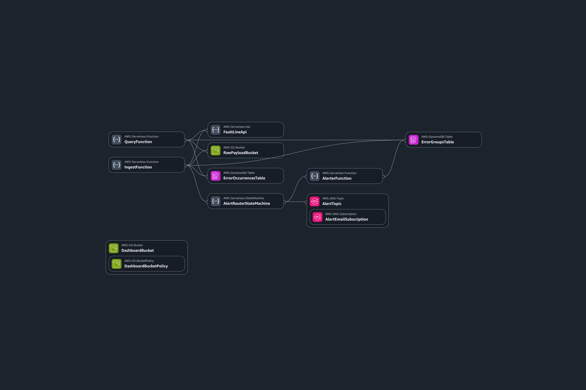

# FaultLine — Serverless Error Tracking & Smart Alerting

> **Built for the AWS Builder Center Weekend Challenge: *No Pipeline, No Problem***
>
> A lightweight, scale-to-zero error tracking and deduplicated alerting platform built entirely on managed serverless AWS services in **Go (`arm64` Graviton2)**.
> **No servers to babysit. No CI/CD pipelines to maintain. $0.00 at rest.**

---

##  The Problem & What FaultLine Does About It

### The Problem
When building side projects, microservices, or internal tools, developers face an unpleasant choice for error monitoring:
1. **Pay for heavy SaaS error trackers** (Sentry, Bugsnag, Datadog) that charge monthly minimums even when your app is idle, or
2. **Self-host an error tracker** on EC2/Docker/RDS—which means maintaining servers, databases, queues, and deployment pipelines that cost more time and money than the app itself, or
3. **Rely on raw logs**, leading to missed production crashes or an inbox flooded with thousands of duplicate alert emails when a loop fails.

### The Solution: FaultLine
**FaultLine** is a self-hosted, 100% serverless error sink, deduplication engine, and smart alert router that deploys to your own AWS account in under 2 minutes with a single `make deploy`:
- **Instant Error Fingerprinting & Grouping:** Incoming errors (`POST /errors`) are hashed by `SHA-256(message + source)` into deterministic error groups and incremented atomically in **Amazon DynamoDB** in a single round-trip.
- **Tiered Payload Storage:** Summary metadata and stack traces are indexed in **DynamoDB** for fast dashboard queries, while full raw JSON payloads are archived to **Amazon S3** with a **30-day automatic lifecycle expiration**.
- **Smart Alert Routing & Noise Suppression:** Instead of spamming your inbox on every error, **AWS Step Functions** orchestrates an alert workflow triggered on the **1st occurrence** and **every 10th occurrence**, enforcing a **30-minute quiet window** before publishing notifications via **Amazon SNS**.
- **Zero-Ops Static Dashboard:** A dark-mode single-page dashboard hosted on **Amazon S3** lets you inspect error groups, occurrence counts, stack traces, and request metadata in real time.

---

##  Architecture

### AWS Infrastructure Composer View


### End-to-End Request & Event Flow
```text
┌──────────────────────┐         ┌────────────────────────┐
│  Client Application  │         │   Developer Browser    │
└──────────┬───────────┘         └───────┬───────────┬────┘
           │                             │           │
     POST /errors                  GET /errors    Load Static UI
           │                       GET /errors/{id}  │
           ▼                             │           ▼
┌────────────────────────────────────────┴──┐   ┌────────────────────┐
│        Amazon API Gateway (/prod)         │   │     Amazon S3      │
└──────────┬─────────────────────────────┬──┘   │  (DashboardBucket) │
           │                             │      └────────────────────┘
           ▼                             ▼
┌──────────────────────┐      ┌──────────────────────┐
│  λ IngestFunction    │      │   λ QueryFunction    │
│  (Go 1.22 · arm64)   │      │  (Go 1.22 · arm64)   │
└──┬────────┬────────┬─┘      └──────────┬───────────┘
   │        │        │                   │
   │        │        └─────────────┐     │
   ▼        ▼                      ▼     ▼
┌────────────────┐  ┌────────────────────────────────┐
│   Amazon S3    │  │        Amazon DynamoDB         │
│RawPayloadBucket│  │ • ErrorGroupsTable (Count, PK) │
│ (30-day TTL)   │  │ • ErrorOccurrencesTable (SK)   │
└────────────────┘  └──────────────▲─────────────────┘
   │                               │
   │ 1st & every 10th hit          │ Read / Update LastNotified
   ▼                               │
┌────────────────────────┐    ┌────┴─────────────────┐
│  AWS Step Functions    ├───▶│  λ AlerterFunction   │
│AlertRouterStateMachine │    │  (30m quiet window)  │
└──────────┬─────────────┘    └──────────────────────┘
           │
           │ If not suppressed
           ▼
┌────────────────────────┐
│      Amazon SNS        │
│ AlertTopic (Email/Hook)│
└────────────────────────┘
```

---

## Step Functions Alert Router Workflow

Defined in [`statemachine/alert_router.asl.json`](./statemachine/alert_router.asl.json) using Amazon States Language (ASL):

```text
  [Triggered on 1st or every 10th occurrence]
                      │
                      ▼
        ┌───────────────────────────┐
        │     CheckSuppression      │
        │   (λ AlerterFunction)     │
        └─────────────┬─────────────┘
                      │
                      ▼
        ┌───────────────────────────┐
        │   ShouldAlert (Choice)    │
        └──────┬─────────────┬──────┘
               │             │
   should_alert = true       should_alert = false
   (1st hit or >30m)         (within 30m window)
               │             │
               ▼             ▼
        ┌─────────────┐ ┌─────────────────┐
        │  SendAlert  │ │ AlertSuppressed │
        │ (SNS Topic) │ │  (No-op Pass)   │
        └──────┬──────┘ └────────┬────────┘
               │                 │
               ▼                 │
        ┌────────────────┐       │
        │ UpdateNotified │       │
        │ (Stamp DDB)    │       │
        └──────┬─────────┘       │
               │                 │
               └────────┬────────┘
                        ▼
                     [ End ]
```

---

##  Serverless AWS Services & Design Choices

| AWS Service | Resource | How It's Used & Why |
|---|---|---|
| **Amazon API Gateway** | `FaultLineApi` | Managed REST API (`POST /errors`, `GET /errors`, `GET /errors/{id}`) with built-in CORS and throttling. |
| **AWS Lambda** (`provided.al2023`, `arm64`) | `IngestFunction`, `QueryFunction`, `AlerterFunction` | Three isolated Go binaries compiled with `-tags lambda.norpc -ldflags="-s -w"` for sub-20ms cold starts on AWS Graviton2 and strict least-privilege IAM roles per function. |
| **Amazon DynamoDB** | `ErrorGroupsTable`, `ErrorOccurrencesTable` | `PAY_PER_REQUEST` (on-demand) tables. Uses atomic `UpdateItem` (`ADD Count :one`, `if_not_exists(FirstSeen, :now)`) to deduplicate concurrent errors without race conditions. |
| **Amazon S3** | `RawPayloadBucket`, `DashboardBucket` | `RawPayloadBucket` archives full error payloads with a 30-day `ExpirationInDays` lifecycle rule; `DashboardBucket` serves the static web UI with zero web servers. |
| **AWS Step Functions** | `AlertRouterStateMachine` | Visual, auditable workflow that checks suppression state via `AlerterFunction` and uses direct **AWS SDK Service Integration** (`arn:aws:states:::sns:publish`) to notify `AlertTopic`. |
| **Amazon SNS** | `AlertTopic` | Fan-out notification delivery to email, SMS, Slack webhooks, or PagerDuty. |

---

##  API Reference

### 1. Ingest an Error — `POST /errors`

**Request:**
```bash
curl -X POST "$API_ENDPOINT/errors" \
  -H "Content-Type: application/json" \
  -d '{
    "message": "null pointer in user handler",
    "source": "api-service",
    "level": "error",
    "stacktrace": "main.go:42 -> handler.go:15",
    "metadata": {"request_id": "abc-123", "user_id": "u-456"}
  }'
```

**Response (`200 OK`):**
```json
{
  "count": 1,
  "group_id": "9f86d081884c7d65",
  "status": "ingested"
}
```

### 2. List Error Groups — `GET /errors`

**Response (`200 OK`):**
```json
{
  "count": 1,
  "errors": [
    {
      "group_id": "9f86d081884c7d65",
      "message": "null pointer in user handler",
      "source": "api-service",
      "level": "error",
      "count": 10,
      "first_seen": "2026-11-15T08:30:00Z",
      "last_seen": "2026-11-15T08:35:12Z",
      "last_notified": "2026-11-15T08:30:01Z",
      "status": "active"
    }
  ]
}
```

### 3. Get Error Group & Recent Occurrences — `GET /errors/{id}`

Returns the group summary plus the 25 most recent occurrences (queried in descending timestamp order via DynamoDB sort key) along with stack traces, metadata, and S3 raw payload keys.

---

## Project Structure

```text
.
├── template.yaml                  # AWS SAM / CloudFormation infrastructure definition
├── Makefile                       # Build, deploy, frontend sync, smoke test, and teardown targets
├── statemachine/
│   └── alert_router.asl.json      # Step Functions state machine definition (Amazon States Language)
├── internal/
│   ├── models.go                  # Shared Go structs (ErrorEvent, ErrorGroup, ErrorOccurrence, AlertInput)
│   └── store.go                   # DynamoDB operations (atomic upsert, queries, suppression timestamps)
├── cmd/
│   ├── ingest/main.go             # IngestFunction entrypoint (POST /errors)
│   ├── query/main.go              # QueryFunction entrypoint (GET /errors, GET /errors/{id})
│   └── alerter/main.go            # AlerterFunction entrypoint (invoked by Step Functions)
└── frontend/
    └── index.html                 # Zero-dependency dark-mode Error Dashboard hosted on S3
```

---

## Quick Start (Deploy in 2 Minutes — No Pipeline Required)

### Prerequisites
- **Go 1.22+**
- **AWS CLI v2** configured with credentials (`aws sts get-caller-identity`)

### 1. Build & Deploy Backend
```bash
make build
make deploy
```
*(Optional: To receive email alerts, pass `--parameter-overrides AlertEmail=you@example.com` to the deploy command and confirm the SNS subscription email.)*

### 2. Get Your Live Endpoints
```bash
aws cloudformation describe-stacks \
  --stack-name faultline \
  --query 'Stacks[0].Outputs' \
  --output table
```

### 3. Deploy the Dashboard UI to S3
```bash
make deploy-frontend
```
Open the `DashboardUrl` from Step 2 (or open `frontend/index.html` locally), paste your `ApiEndpoint` URL, and click **Connect**.

### 4. Send Test Errors
```bash
make test-ingest
```
- Run it **once**: creates the error group (`count: 1`) and triggers Step Functions → sends an SNS alert.
- Run it **9 more times**: increments `count` to `10` and triggers Step Functions again → Step Functions automatically **suppresses** the duplicate alert inside the 30-minute quiet window!

### 5. Clean Teardown (When Done)
```bash
make destroy
```
Empties the S3 buckets and deletes the entire CloudFormation stack in one command.

---

## Scale-to-Zero Cost Breakdown

| Service | Pricing Model | Cost When Idle | AWS Free Tier Coverage |
|---|---|---|---|
| **AWS Lambda** (`arm64`) | Per invocation / ms | **$0.00** | 1M requests + 400,000 GB-sec/month (Always Free) |
| **Amazon DynamoDB** | `PAY_PER_REQUEST` | **$0.00** | 25 GB storage + 25 WCU/RCU (Always Free) |
| **AWS Step Functions** | Per state transition | **$0.00** | 4,000 state transitions/month (Always Free) |
| **Amazon SNS** | Per notification | **$0.00** | 1,000 email notifications/month (Always Free) |
| **Amazon API Gateway** | Per API call | **$0.00** | 1M REST calls/month (12 months free) |
| **Amazon S3** | Per GB stored | **$0.00** | 5 GB storage (12 months free) + 30-day auto-expiry |
